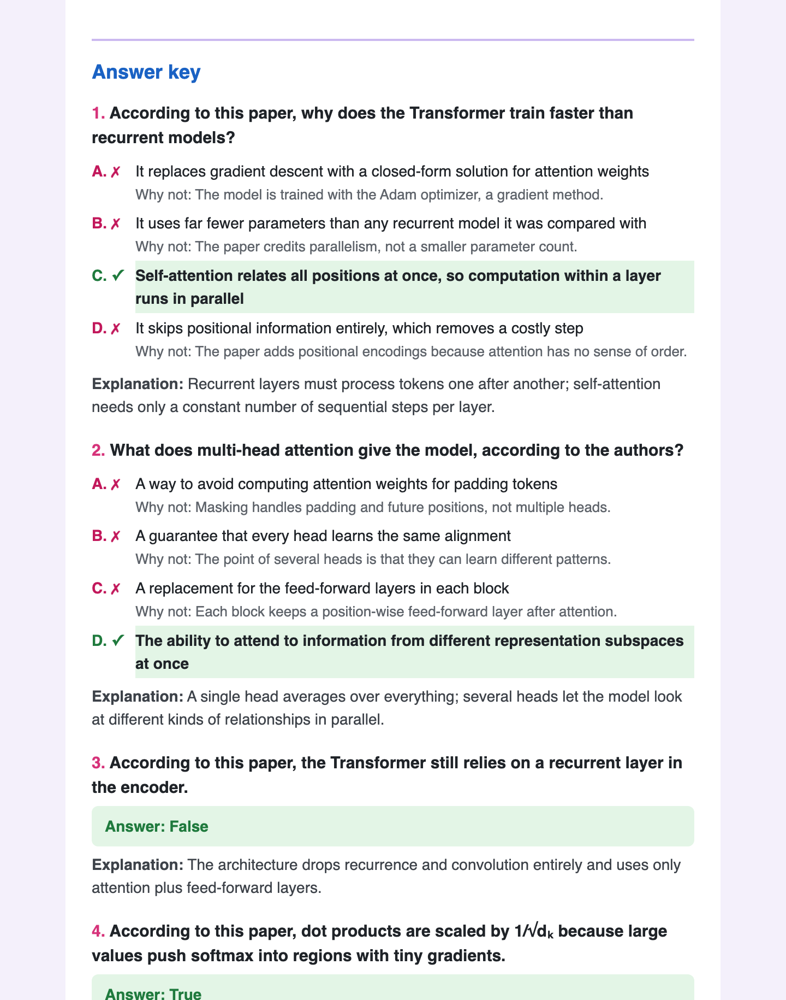
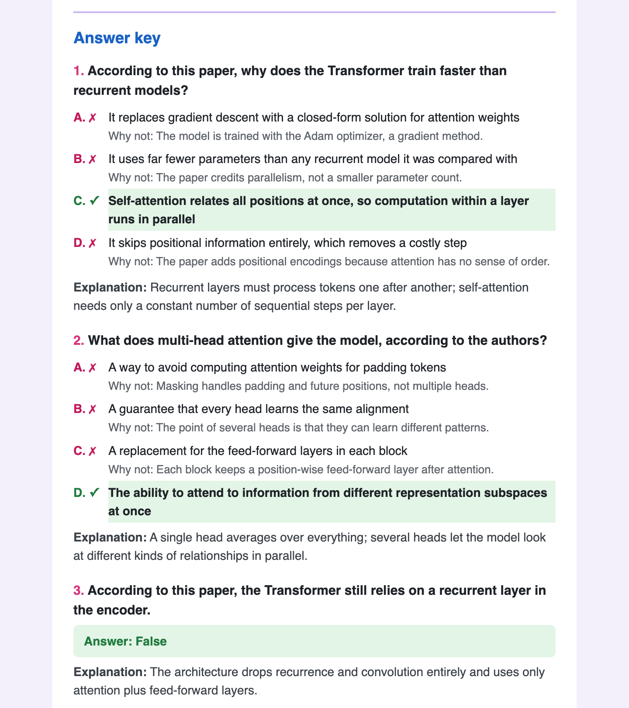
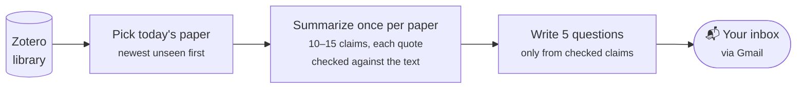

# Daily Zotero Quiz

**Get one short quiz in your inbox every morning on a paper from your Zotero library, so you remember what you read.**

[](.github/workflows/daily-quiz.yml)
[](pyproject.toml)
[](https://www.zotero.org/support/dev/web_api/v3/start)
[](https://docs.anthropic.com)
[](LICENSE)

Saving papers is easy, but remembering them is hard. Each morning, this project picks one paper from your Zotero library, has Claude write 5 questions on its main ideas, and emails them to you. Answering them takes a couple of minutes, and that active recall is what makes the ideas stick.

- **Free to host:** it runs on GitHub Actions. You don't need a server or a database.
- **About 1¢ a day or less:** both steps use Claude Haiku 5.5. A typical run costs 0.3–1¢.
- **Grounded in the paper:** every question is built from claims that come with a quote from the paper, and code checks that each quote really appears in the text.
- **Newest papers first:** papers you saved recently and haven't seen come first. Once every paper has had a quiz, it cycles back with new questions.
- **About 15 minutes to set up**, with three API keys and no coding.

## What the email looks like

Five questions on top (2 multiple choice, 2 true/false, 1 open-ended), with the answer key below. The key marks the correct option, says why each wrong option is wrong, and gives a short explanation.

| Questions | Answer key |
|---|---|
|  |  |

*This sample was written by hand for a well-known paper. Open [`docs/example-email.html`](docs/example-email.html) for the full email, or rebuild it with `python scripts/render_example.py`.*

## How it works



1. **Pick a paper** from your Zotero *My Library* (journal articles, conference papers, preprints, reports, theses, books and book sections). Papers that have never been quizzed come first, newest first; after that, the one quizzed longest ago.
2. **Summarize it, once per paper.** Claude reads the abstract, your notes, your PDF highlights and the PDF's full text, and pulls out 10–15 claims (problem, method, findings, limitations, implications), each with a short quote. Code drops any claim whose quote can't be found in the paper. The summary is saved in `summaries/` and reused next time.
3. **Write the quiz.** Claude writes 5 questions using only those checked claims. Each wrong multiple-choice option has to be something the paper contradicts, not just something it doesn't mention. Code shuffles the options so the correct one lands in a random spot.
4. **Send and record.** The email goes out through Gmail, and the paper and date are recorded in `state.json`, which the workflow commits back to your repo.

## Setup (about 15 minutes)

You need a GitHub account, a Zotero account with your papers synced, a Gmail account to send from, and an Anthropic API account with a few dollars of credit.

### Step 1: Make your own copy of this repo

Click **Use this template → Create a new repository** at the top of this page, and choose **Private**.

> **Why private?** Every day the workflow commits `state.json` (which papers you were quizzed on), `library.json` (your list of papers) and `summaries/` (quotes from your papers) back to the repo. In a public repo, anyone could see your reading list. A private repo stays well within GitHub's free Actions minutes, since each run takes about a minute.

### Step 2: Get a Zotero API key and user ID

1. Go to [zotero.org/settings/keys](https://www.zotero.org/settings/keys) and sign in.
2. At the top, copy the number after **"Your userID for use in API calls is"**. This is your `ZOTERO_USER_ID` (for example `1234567`).
3. Click **Create new private key** and name it something like `daily quiz`. Under **Personal Library**, tick **Allow library access** and **Allow notes access** (so your own notes can feed the quiz). Leave **Allow write access** off; the quiz only reads.
4. Click **Save Key** and copy the key. This is your `ZOTERO_API_KEY`.

**For good quizzes, Zotero needs the full text of your PDFs.** In the Zotero desktop app, open *Settings → Sync* and make sure **Sync full-text content** is on and your PDFs are stored in Zotero (not as linked files). Without it, only abstracts and notes are available, and papers with under 1,500 characters of text are skipped.

### Step 3: Create a Gmail app password

The quiz is sent from a Gmail account using an app password: a separate 16-character password for this one app. You can use your own Gmail or make a new account just for sending.

1. Turn on **2-Step Verification** for that Google account at [myaccount.google.com/security](https://myaccount.google.com/security). App passwords require it.
2. Go to [myaccount.google.com/apppasswords](https://myaccount.google.com/apppasswords), type a name like `daily quiz`, and click **Create**.
3. Copy the 16 characters (spaces don't matter). This is your `GMAIL_APP_PASSWORD`.

Some Google Workspace (work or school) accounts don't allow app passwords. If the page says the setting isn't available, send from a personal Gmail account instead. The quiz can still go to any address through `RECIPIENT_EMAIL`.

### Step 4: Get an Anthropic API key

1. Sign in at [console.anthropic.com](https://console.anthropic.com).
2. Under **Billing**, add credit. $5 lasts well over a year at about 1¢ a day.
3. Under **API keys** ([direct link](https://console.anthropic.com/settings/keys)), click **Create key** and copy it (it starts with `sk-ant-`). This is your `ANTHROPIC_API_KEY`.

### Step 5: Add the keys to your repo as secrets

In your new repo, go to **Settings → Secrets and variables → Actions → New repository secret**, and add each of these:

| Secret | Required? | Example |
|---|---|---|
| `ZOTERO_API_KEY` | yes | `aB3dE5fG7hI9jK1lM3nO5pQ7` |
| `ZOTERO_USER_ID` | yes | `1234567` |
| `ANTHROPIC_API_KEY` | yes | `sk-ant-api03-...` |
| `GMAIL_ADDRESS` | yes | `my.quiz.bot@gmail.com` |
| `GMAIL_APP_PASSWORD` | yes | `abcdefghijklmnop` |
| `RECIPIENT_EMAIL` | no | `me@university.edu` (defaults to `GMAIL_ADDRESS`) |
| `ERROR_EMAIL` | no | where failure reports go (defaults to `RECIPIENT_EMAIL`) |

**Shortcut with the [GitHub CLI](https://cli.github.com):** fill in a `.env` file (see [Run it on your computer](#run-it-on-your-computer)), then upload every secret in it with one command from the repo folder:

```bash
gh secret set -f .env
```

### Step 6: Send your first quiz

Go to the **Actions** tab of your repo. If GitHub asks, click **I understand my workflows, go ahead and enable them**. Then open **Daily quiz → Run workflow → Run workflow**.

After a minute or two you should have an email, and a new commit called *"Record quiz for YYYY-MM-DD"* in your repo. From now on it runs every morning by itself.

> **Tip:** the first quiz on each paper also summarizes it. To summarize your whole library ahead of time at half price, run `python -m quiz.main --summarize-all` once on your computer (it uses the Batch API and usually finishes within an hour), then commit the new files in `summaries/`.

## Choose when it arrives

The schedule is in [`.github/workflows/daily-quiz.yml`](.github/workflows/daily-quiz.yml). There are three times, because GitHub sometimes starts scheduled runs late or skips them. The first run of the day sends the quiz; the others see it was already sent and stop.

```yaml
schedule:
  - cron: "37 14 * * *"   # 14:37 UTC
  - cron: "23 15 * * *"   # backup
  - cron: "41 16 * * *"   # backup
```

Times are in **UTC** and don't follow daylight saving. To get the first send around 7 am:

| Where you are | First cron line |
|---|---|
| US Pacific (PST, UTC−8) | `"37 14 * * *"` (the default) |
| US Eastern (EST, UTC−5) | `"37 11 * * *"` |
| UK (GMT) | `"37 6 * * *"` |
| Central Europe (CET, UTC+1) | `"37 5 * * *"` |
| China (UTC+8) | `"37 23 * * *"` (the evening before, in UTC) |

Move the two backup lines to match, about an hour apart. Odd minutes like `:37` work better than `:00`, when GitHub is busiest. If your send time falls on the previous day in UTC, the date shown in the email is the UTC date.

## Run it on your computer

Handy for trying it out before setting up GitHub, or for testing changes.

```bash
git clone https://github.com/<you>/<your-repo>.git && cd <your-repo>
python3 -m venv .venv && source .venv/bin/activate
pip install -e '.[dev]'
cp .env.example .env
```

Then fill in `.env`. It's in `.gitignore`, so it never gets committed:

```ini
ZOTERO_API_KEY=aB3dE5fG7hI9jK1lM3nO5pQ7
ZOTERO_USER_ID=1234567
ANTHROPIC_API_KEY=sk-ant-api03-...
GMAIL_ADDRESS=my.quiz.bot@gmail.com
GMAIL_APP_PASSWORD=abcdefghijklmnop
RECIPIENT_EMAIL=me@university.edu
ERROR_EMAIL=
```

Commands:

```bash
python -m quiz.main --survey                         # how many papers qualify, and text length for 3 of them
python -m quiz.main --dry-run                        # write the email to out/preview.html; sends nothing
python -m quiz.main --item-key ABCD1234 --no-email   # print a quiz for one paper as JSON
python -m quiz.main                                  # the real thing: send the email and update state.json
python -m quiz.main --summarize-all                  # summarize every paper without a summary (Batch API, half price)
python -m quiz.main --refresh-library                # re-fetch your Zotero paper list now
pytest                                               # run the tests (no network needed)
```

`--dry-run` and `--no-email` don't need the Gmail settings and never change `state.json`. A good first check is `--survey`, then `--dry-run`. An item key is the 8-character ID at the end of a paper's URL on zotero.org, or from *Copy Item Link* in the Zotero app.

## Customize it

| What | Where |
|---|---|
| Number and kinds of questions | `QUESTION_MIX` in [`src/quiz/config.py`](src/quiz/config.py) (default: 2 multiple choice, 2 true/false, 1 open-ended) |
| Which Claude model | `SUMMARY_MODEL` and `QUIZ_MODEL` in [`src/quiz/config.py`](src/quiz/config.py). For deeper questions, set `QUIZ_MODEL = "claude-sonnet-5-5"` (about 20× the cost, still a few cents) |
| What the questions focus on | `SYSTEM_PROMPT` in [`src/quiz/generator.py`](src/quiz/generator.py) |
| What the summary pulls out | `SUMMARY_SYSTEM` in [`src/quiz/summarizer.py`](src/quiz/summarizer.py). After changing it, delete the files in `summaries/` so they're rebuilt |
| Which item types count as papers | `ELIGIBLE_ITEM_TYPES` in [`src/quiz/config.py`](src/quiz/config.py) |
| How the email looks | [`templates/quiz_email.html.j2`](templates/quiz_email.html.j2) (inline CSS only, so it works in email apps) |
| Another email provider | `send()` in [`src/quiz/emailer.py`](src/quiz/emailer.py) is a few lines of `smtplib`; change the host and port for any SMTP service |

## Good to know

**New papers can take up to 30 days to show up.** Your Zotero paper list is fetched at most once every 30 days and cached in `library.json`. To pull in new papers right away, run the workflow by hand and tick **Re-fetch the Zotero item list now**, or run `--refresh-library` locally. Change the interval with `LIBRARY_MAX_AGE_DAYS` in `config.py`.

**What the quiz is built from:** the abstract, your Zotero notes, your PDF highlights and comments, and the PDF's full text from Zotero's index (up to 60,000 characters).

**When a run fails,** you get a short email at `ERROR_EMAIL` with the step that failed, the error, and a link to the run log.
- If the paper itself is the problem (Claude couldn't make a valid summary or quiz from it), it's added to `failures` in `state.json` and skipped from then on. Delete its entry there to try again.
- Anything else (a service down, an expired key) records nothing, and a backup run later that day tries again.
- If Gmail is what's broken, the failure email can't go out either, but GitHub still emails your GitHub account about the failed run.

**A manual run always sends,** even if today's quiz already went out.

## Project layout

```
.github/workflows/daily-quiz.yml   daily schedule; commits state back to the repo
src/quiz/
  main.py            command line and the daily run, step by step
  zotero_client.py   reads papers, notes, highlights and full text from Zotero
  library.py         caches the paper list in library.json
  selector.py        picks today's paper
  summarizer.py      quote-checked claims, once per paper
  generator.py       the quiz, built from those claims
  emailer.py         renders and sends the email
  state.py           state.json: what was sent and what failed
templates/           the email template
scripts/             renders the sample email in docs/
state.json           quiz history (starts empty)
summaries/           one saved summary per paper
```

## License

[PolyForm Noncommercial 1.0.0](LICENSE). You're free to use, copy and change this project for personal, academic, research and other noncommercial purposes. Commercial use is not allowed without permission; open an issue to ask.

If this helps you remember your reading, a ⭐ helps other researchers find it.
